<!--
  MOBILE SUIT // BUCCKYY
  Visual language sampled from the official Hathaway site (gundam-official.com/hathaway).
  Backgrounds are cropped key-visual stills from that site (fan tribute, (c) Sotsu / Sunrise);
  lettering, HUD and animation are original self-hosted SVGs in /assets (see tools/*.py).
-->

  

> I build **LLM agents that survive production**: routing, tool calls, structured outputs, validation and fallback loops that fail visibly instead of silently. I train deep models for physiological signals, ship the whole line from data to model to orchestration to edge, and like the hard part: getting neural nets to run **on-device**, not just in a notebook.

Plain-text summary

**Tran Trung Duc (BuccKyy)**, AI Engineer at MaxflowAI, Ho Chi Minh City. Seeking AI / agent engineer roles, fully remote; works with async-first teams worldwide.

- **MaxflowAI (2026 to now):** multi-agent systems for real clients across event ops, B2B sales automation, inventory logistics, email pipelines and HR; Python and JSON orchestration, CRM / SMS / SMTP connectors, Playwright QA.
- **ITR VN (Nov 2024 to Jan 2025):** PPG2BP-Net for cuffless blood pressure (SBP MAE 9.76, DBP MAE 5.25 mmHg); NumPy vectorisation cut latency about 40%; STM32 + MAX30102 prototype.
- **SNOW Vietnam (Apr to Oct 2025):** product review and QA for AI AR filters and computer-vision effects.
- **Awards:** VPBank Technology Hackathon 2025 (Senior Track); Biomedical Engineering Innovation Competition 2025 (Team Lead).
- **Selected projects:** [agent-reliability-kit](https://github.com/BuccKyy/agent-reliability-kit) (validated tool-call loop, tested), [payment-approval-agent-n8n](https://github.com/BuccKyy/payment-approval-agent-n8n), [ai-news-agent-n8n](https://github.com/BuccKyy/ai-news-agent-n8n), [prompt-master-for-codex](https://github.com/BuccKyy/prompt-master-for-codex), [Deep-PPG-Research-Core](https://github.com/BuccKyy/Deep-PPG-Research-Core), [Cuffless-BP-IoT-System](https://github.com/BuccKyy/Cuffless-BP-IoT-System). Most client work is in private repositories.
- **Education:** B.Eng. Electronics and Telecommunication, VNU-HCM, GPA 3.4 / 4.0.
- **Links:** [Portfolio](https://bucckyy.github.io) · [CV (PDF)](https://bucckyy.github.io/TranTrungDuc-AI-Engineer-CV.pdf) · [LinkedIn](https://www.linkedin.com/in/tranductrung-ai/) · trantrungduc313@gmail.com

