<!--
  MOBILE SUIT // BUCCKYY
  Visual language sampled from the official Hathaway site (gundam-official.com/hathaway):
  void navy, periwinkle, hologram cyan, condensed caps, hairline HUD, CRT scanlines.
  Backgrounds are cropped key-visual stills from the official Hathaway site (fan tribute, (c) Sotsu / Sunrise); lettering, HUD and animation are original self-hosted SVGs in /assets.
-->

  

  

  <a href="https://github.com/BuccKyy?tab=repositories">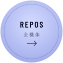</a>
  <a href="mailto:trantrungduc313@gmail.com"></a>


> **PILOT LOG.** I build **LLM agents that survive production**: routing, tool calls, structured outputs, validation and fallback loops that fail visibly instead of silently. I train deep models for physiological signals, ship the whole line from data to model to orchestration to edge, and like the hard part: getting neural nets to run **on-device**, not just in a notebook.

<table width="100%">
<tr><td></td><td></td><td></td></tr>
</table>


<table width="100%">
<tr><td><a href="https://github.com/BuccKyy/Deep-PPG-Research-Core"></a></td><td><a href="https://github.com/BuccKyy/Cuffless-BP-IoT-System"></a></td></tr>
<tr><td><a href="https://github.com/BuccKyy/Video-Translation-Tool"></a></td><td><a href="https://github.com/BuccKyy/prompt-master-for-codex"></a></td></tr>
<tr><td><a href="https://github.com/BuccKyy/Medical_Clinic_Booking-System_Ultrasound_Clinic"></a></td><td><a href="https://github.com/BuccKyy/IoT-System-Data-Pipeline_Cuffless-Blood-Pressure-"></a></td></tr>
</table>

  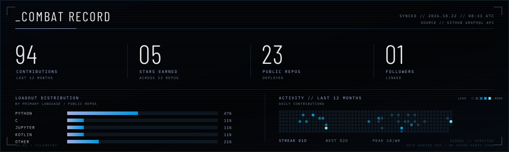
 
  

  LIVE FEED // regenerated daily from the GitHub GraphQL API by GitHub Actions. No third-party cards, no rate-limit blanks.

<table width="100%">
<tr><td><a href="https://github.com/BuccKyy"></a></td><td></td><td></td><td></td></tr>
</table>

  

