<!-- Hero banner + footer are self-hosted animated SVGs in /assets — no third-party service, never breaks. -->

  

  

  
  

---

### 🧠 About me

- 🤖 **AI Engineer** — I build **LLM agents & agent workflows** end-to-end (currently at **MaxflowAI**)
- 🔬 I train **deep learning models for physiological signals** — cuffless blood pressure from raw PPG
- 🧩 I ship the whole loop: **data → model → RAG/agent orchestration → edge & mobile deployment**
- ⚡ I like the hard part: getting neural nets to run **on-device** (STM32 / mobile), not just in a notebook
- 🌱 Going deeper on **agentic systems, retrieval, and on-device inference**

---

### 🛠️ Tech Stack

**LLM & Agents**

  
  
  
  
  

**ML / Deep Learning**

  
  
  
  
  
  

**Languages & Edge**

  
  
  
  
  

---

### 📊 GitHub Stats

  
  

  

> If a stats card ever shows blank, its host (vercel) is rate-limited — refresh in a minute. The banner and footer are self-hosted SVGs and always render.

---

### 🚀 Featured Projects

| Project | What it is |
|---|---|
| 🧪 [Deep-PPG-Research-Core](https://github.com/BuccKyy/Deep-PPG-Research-Core) | End-to-end **deep learning** framework for PPG-based blood pressure prediction |
| 🩸 [Cuffless-BP-IoT-System](https://github.com/BuccKyy/Cuffless-BP-IoT-System) | Real-time cuffless BP monitoring with **edge AI** on-device inference |
| 🎬 [Video-Translation-Tool](https://github.com/BuccKyy/Video-Translation-Tool) | **AI-powered** video translation pipeline |
| 📈 [PPG2BP-Deep-Learning](https://github.com/BuccKyy/PPG2BP-Deep-Learning) | Neural nets mapping PPG waveforms → blood pressure |

---

  

